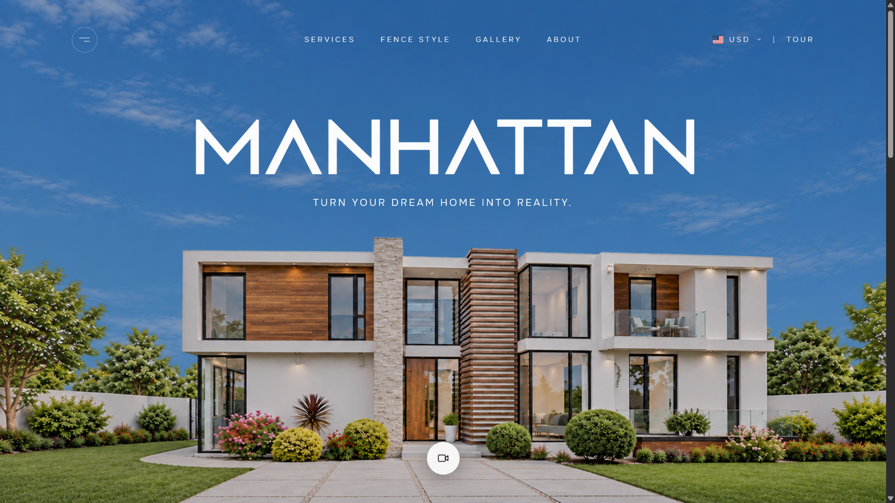

# MANHATTAN


## Preview


<p align="center">
  
</p>

**Turn your dream home into reality.**

Manhattan is a real estate website front end, designed in Figma and built with React. It focuses on a cinematic first impression: a multi-layer parallax hero, heavy-but-smooth scrolling, a switchable image and video background, and a refined navigation bar with a searchable currency selector.

This repository currently contains the hero section, the navigation, and the first content sections. More sections will be added as the design progresses.

---

## Table of Contents

1. [Overview](#overview)
2. [Features](#features)
3. [Tech Stack](#tech-stack)
4. [Getting Started](#getting-started)
5. [Available Scripts](#available-scripts)
6. [Project Structure](#project-structure)
7. [Assets](#assets)
8. [How It Works](#how-it-works)
9. [Customization](#customization)
10. [Testing on a Phone](#testing-on-a-phone)
11. [Video Optimization](#video-optimization)
12. [Browser Support](#browser-support)
13. [Roadmap](#roadmap)
14. [License](#license)

---

## Overview

The goal of this project is a premium, editorial feel for a real estate brand. The design was created in Figma and translated into code with attention to proportion, spacing and motion.

Key design decisions:

- A layered hero (sky, logo, house) where the house slowly slides up and covers the MANHATTAN wordmark as you scroll.
- Smooth, slightly weighted scrolling powered by Lenis.
- A transparent navigation bar over the hero that becomes a solid bar once the hero has been passed.
- An Image and Video toggle in the hero, so the same space can show either the architectural photograph or a property walkthrough.
- Onest as the single typeface, used in thin weights with wide letter spacing for the navigation.

---

## Features

**Hero**

- Three-layer 2.5D parallax: sky, MANHATTAN wordmark with tagline, and the house.
- The house scrolls at normal speed and covers the wordmark, while the wordmark drifts up only slightly.
- The hero is always as tall as the full house image, so the bottom of the house is never cropped at any window size.
- Entrance animation: the sky settles, the house rises, then the wordmark, tagline and controls fade in.
- Floating action button to switch between the image background and the video background.
- In video mode, the wordmark and tagline glide down smoothly over the video.
- Video controls: play, pause, mute and unmute.
- The video loads lazily, only the first time it is requested, and pauses when scrolled out of view.
- Mobile only: an Explore button below the tagline that scrolls smoothly to the next section.

**Navigation**

- Transparent over the hero, solid white bar after the hero has been passed.
- Perfectly centered navigation links using a three-column grid.
- Thin, widely spaced uppercase typography.
- Currency selector with a search field, round flags in the list, and a rectangular flag on the button.
- The selected currency is remembered between visits.
- Keyboard support: arrow keys move through the list, Enter selects, Escape closes.
- All navigation items appear together during the intro animation.

**Content Sections**

- Who We Are: white background, text on the left, image on the right, with placeholder content.
- About: light background, image on the left, text on the right, with three numbered values and placeholder content.
- A reusable `Reveal` component that fades and slides any content in as it enters the screen.

**Performance and Polish**

- GPU-accelerated transforms for all moving layers.
- Smoothed scroll scrubbing to remove jitter on touch devices.
- Mobile address-bar resizes do not trigger layout recalculation.
- The Lenis smooth scroll is bypassed inside the currency list so the mouse wheel scrolls it naturally.

---

## Tech Stack

| Area | Technology |
| --- | --- |
| Framework | React 19 |
| Build tool | Vite 8 |
| Styling | Tailwind CSS 4 (via `@tailwindcss/vite`) |
| Animation | GSAP and ScrollTrigger |
| Smooth scroll | Lenis |
| Flags | flag-icons |
| Typography | Onest (Google Fonts) |
| Linting | ESLint 10 with React Hooks and React Refresh plugins |

---

## Getting Started

### Prerequisites

- Node.js 20 or newer
- npm

### Installation

```bash
# 1. Clone the repository
git clone https://github.com/<your-username>/manhattan.git
cd manhattan

# 2. Install dependencies
npm install

# 3. Start the development server
npm run dev
```

The site will be available at `http://localhost:5173`.

If you are setting the project up from scratch, the extra dependencies are installed with:

```bash
npm install lenis gsap tailwindcss @tailwindcss/vite flag-icons
```

---

## Available Scripts

| Command | Description |
| --- | --- |
| `npm run dev` | Start the development server with hot reload |
| `npm run build` | Create an optimized production build in `dist/` |
| `npm run preview` | Serve the production build locally |
| `npm run lint` | Run ESLint across the project |

---

## Project Structure

```
manhattan/
├── public/
│   ├── hero-section/
│   │   ├── modern-house.png      Transparent cutout of the house (1280 x 720)
│   │   └── muted-sky.png         Sky background (1280 x 720)
│   ├── manhattan/
│   │   └── manhattan.png         White MANHATTAN wordmark on transparent
│   ├── mp4/
│   │   ├── manhattan.mp4         Compressed hero video
│   │   └── poster.jpg            Still frame shown while the video loads
│   ├── favicon.svg
│   └── icons.svg
├── src/
│   ├── components/
│   │   ├── Hero.jsx              Parallax hero, video mode, floating action button
│   │   ├── Navbar.jsx            Navigation bar and currency selector
│   │   ├── WhoWeAreSection.jsx   Who We Are section (placeholder content)
│   │   ├── AboutSection.jsx      About section (placeholder content)
│   │   └── Reveal.jsx            Reusable scroll-reveal wrapper
│   ├── hooks/
│   │   └── useSmoothScroll.js    Lenis setup synchronized with GSAP
│   ├── App.jsx                   Page composition
│   ├── main.jsx                  Application entry point
│   └── index.css                 Tailwind import, theme, hero layout rules
├── index.html
├── vite.config.js
├── eslint.config.js
└── package.json
```

---

## Assets

| File | Purpose | Notes |
| --- | --- | --- |
| `hero-section/muted-sky.png` | Back layer of the hero | 1280 x 720 |
| `hero-section/modern-house.png` | Front layer of the hero | 1280 x 720, transparent background |
| `manhattan/manhattan.png` | Wordmark | White on transparent |
| `mp4/manhattan.mp4` | Hero video | Web-optimized, H.264, faststart |
| `mp4/poster.jpg` | Video poster frame | Extracted from the video |

The sky and the house share the same dimensions and aspect ratio, so they line up exactly as they do in the Figma frame.

---

## How It Works

### Hero layers

The hero is built from stacked layers, from back to front:

1. **Sky:** drifts down slowly as you scroll.
2. **Wordmark and tagline:** pinned to the screen and clipped to the hero, with a small upward drift.
3. **House:** scrolls with the page at normal speed, so it slides up over the wordmark.
4. **Video layer:** fades in over the house when video mode is active.

The hero height is `max(100svh, 56.25vw)`. On a screen that is wider than 16:9, the hero becomes slightly taller than the viewport so the house is never cropped, and the wordmark position is expressed as a percentage of that height so it always matches the Figma proportions.

### Smooth scrolling

Lenis handles the wheel and trackpad input with a low `lerp` value for a weighted feel. It is driven by the GSAP ticker so ScrollTrigger and Lenis always agree on the scroll position. Anchor links scroll smoothly as well.

### Navbar behavior

The navbar listens to the position of the hero. While any part of the hero is behind it, the bar stays transparent with white text. Once the bottom of the hero passes the top of the screen, it transitions to a solid white bar with dark text.

### Currency selector

The selector is a self-contained dropdown inside `Navbar.jsx`. It supports filtering by code or name, closes on outside click, Escape or page scroll, and saves the choice to `localStorage`. Prices are not yet connected to it.

---

## Customization

### Replace the placeholder content

- **Who We Are:** edit the headline, paragraphs and `stats` array in `WhoWeAreSection.jsx`. Set `WHO_IMAGE` to a path such as `/who-we-are/who.jpg` once you add the image to `public/`.
- **About:** edit the headline, paragraph and `values` array in `AboutSection.jsx`. Set `ABOUT_IMAGE` the same way.

### Tune the hero

Constants at the top of `Hero.jsx`:

| Constant | Effect |
| --- | --- |
| `LOGO_DRIFT` | How far the wordmark drifts up while scrolling. `0` pins it completely |
| `VIDEO_SHIFT` | How far the wordmark travels down in video mode |

Other adjustments:

- Image and sky brightness: the `brightness-[...]` classes on the sky and house images.
- Dim over the video: the `bg-black/25` overlay.
- Scroll weight: `lerp` and `wheelMultiplier` in `useSmoothScroll.js`.

### Tune the navbar

Constants at the top of `Navbar.jsx`:

| Constant | Effect |
| --- | --- |
| `NAV_FONT_SIZE` | Font size of all navigation text |
| `HERO_EXIT_OFFSET` | When the solid bar appears after leaving the hero |
| `CTA_LABEL` | Text of the button on the right |
| `currencies` | List of currencies, with names and flag codes |

### Add a new section

Create a component, wrap its content in `Reveal` for entrance animations, and add it to `App.jsx` after `Hero`.

---

## Testing on a Phone

The development server is exposed on the local network. With the phone on the same Wi-Fi network as the computer:

1. Run `npm run dev`.
2. Open the **Network** address printed in the terminal (for example `http://192.168.1.15:5173`) on the phone.

If the phone cannot connect, allow Node.js through Windows Firewall on private networks and make sure the Wi-Fi network profile is set to Private.

---

## Video Optimization

Large videos slow down a website. The included hero video was compressed with ffmpeg:

```bash
ffmpeg -i manhattan.mp4 \
  -c:v libx264 -crf 29 -preset slow -profile:v high -pix_fmt yuv420p \
  -vf "scale='min(1600,iw)':-2" -r 30 \
  -c:a aac -b:a 64k -movflags +faststart \
  manhattan-web-small.mp4
```

To create the poster image:

```bash
ffmpeg -i manhattan-web-small.mp4 -ss 00:00:01 -vframes 1 -q:v 3 poster.jpg
```

Tips:

- Do the compression in a folder outside the project to avoid file locks from editor previews on Windows.
- Lower `-crf` values give higher quality and larger files. Values between 26 and 29 work well for background video.

The Vite config ignores `public/mp4/` in the file watcher to prevent `EBUSY` errors on Windows when a video is open in an editor.

---

## Browser Support

The project targets current versions of Chrome, Edge, Firefox and Safari on desktop, and Safari on iOS and Chrome on Android on mobile. It relies on modern CSS features such as `svh` units, `clamp()`, `clip-path` and `backdrop-filter`.

---

## Roadmap

- Full-screen menu panel for the menu button
- Services section
- Fence Style section
- Gallery section
- Private Viewing and Tour request flow
- Property listings with live currency conversion
- Final content, copy and imagery to replace placeholders
- Accessibility audit and reduced-motion support
- SEO metadata and social preview images

---

## License

This project is proprietary and all rights are reserved unless a license is added. To make the project open source, add a `LICENSE` file to the repository root and update this section.

---

## Credits

- Interface design: created in Figma
- Typeface: [Onest](https://fonts.google.com/specimen/Onest)
- Smooth scrolling: [Lenis](https://github.com/darkroomengineering/lenis)
- Animation: [GSAP](https://gsap.com)
- Flags: [flag-icons](https://github.com/lipis/flag-icons)